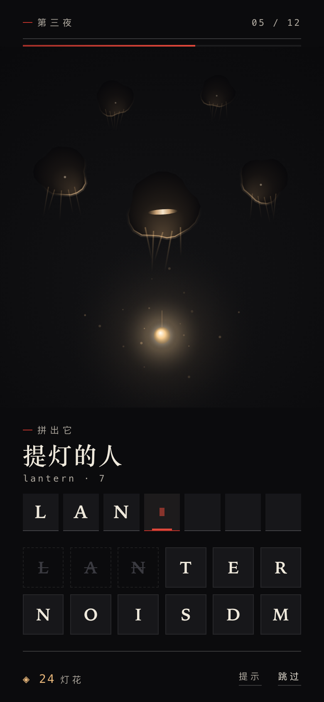
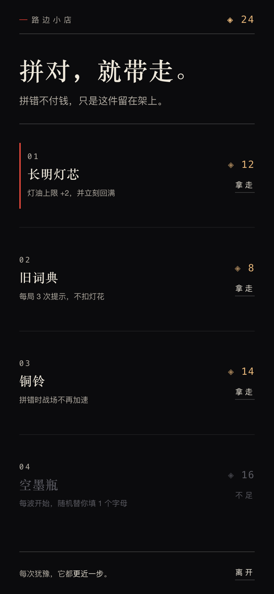

# 《词兽守夜》设计方案

> 类型：拼词肉鸽（Spell-Roguelike）· 竖屏 H5 小工具
> 状态：待评审 · 2026-11-11
> 参考源：`piclex-web`（玩法与拼词交互）、`ohmygame`（视觉语言与 Project Style）、
> `awesome-kimi-k3-game`（渲染技法与打击感）、`game-art-prompt-pack`（素材规格方法论）、
> `game-asset-generator`（美术流程）

---

## 界面草图

按 390×844 实际渲染，不是示意图，像素尺寸与最终一致（不是最终美术，是版式验证）。

| 战斗 | 路边小店 |
|---|---|
|  |  |

两版草图的迭代记录：第一版战场只给了 402px，词兽缩到 26px，认不出形态，底部字母砖下方空出 300px。
第二版把战场加到 470px、词兽放大、营火改成提灯、底部补了随身装备栏。
**这是"必须在真机尺寸上验版式"的实证**——同一个布局在 1920 宽的设计稿里看不出空。

第三版按 `ohmygame` 的 Project Style 重做（见 §5），并修掉三处只有真机才暴露的问题：
词兽一开始是纯黑团块、像墨滴，加下垂触须与体内透光后才成"悬着的生物"；
顶部油量线原本 `0.8cqw` 太粗，读成进度条而不是血线，压到 `0.5cqw`；
商店页的换行在小屏上会留单字成行（"步。"），英文排版里的孤儿行，中文同样要防。

---

## 0. 为什么要"游戏化"，而不是再做一个拼词工具

账号里已有 **「成语拼拼 Daily Word — 看释义拼成语」**（1.0.1 已发布）。
如果英语版做成"看释义拼单词"，无论美术怎么换，用户第一眼就是"成语拼拼的英文版"，没有新品类。

参考项目给的正是一个差异点：**piclex 把背单词做成了肉鸽**——
拼对单词不是得分，而是"买到装备/打死怪"的唯一手段。学习动作被塞进了游戏的因果链里。

所以本作的定位不是"背单词工具带点游戏"，而是：

> **一款为了拼对下一个词而不想关掉的小游戏，词库是它的弹药。**

学习效果的来源不是"一次背多少"，而是**想再玩一局**。

---

## 1. 从《薯薯求生》拆出来的 5 条机制

不是照抄，是拆出可复用的结构。每条都附源码位置，方便后续对照。

| # | 机制 | 原作实现 | 为什么值得留 |
|---|---|---|---|
| 1 | **波次循环**：战斗 → 商店 → 下一波，20 波收尾 | `waves.mjs`（每波 `duration` / `maxEnemies` / 分组刷怪）、`rules.mjs:16` 敌人每波线性成长 | 短局 + 明确的"再来一波"钩子，天然适合碎片时间 |
| 2 | **商店即决策**：4 件商品、可换批、可锁定、可回收、可合成 | `main.mjs:215-232`、`data/shop.mjs`（稀有度按波次解锁：`tier2` 从第 1 波、`tier3` 从第 3 波、`tier4` 从第 7 波） | 构筑感来自"选什么"，不是"打多少" |
| 3 | **拼词门槛**：买东西必须把商品对应的词拼出来，拼对才发货 | `main.mjs:226` → `renderShop` 的 `data-offer` → `beginPurchase` → 拼写面板；`main.mjs:422` 失败提示"购买失败，正确拼写：xxx" | **这是核心创意**：把消费动作变成学习动作 |
| 4 | **字母砖银行**：打乱的目标词字母，每个物理砖有唯一 id，重复字母是独立砖，空槽保留位置不塌缩 | `letter-tiles.mjs`（`createTileBank` / `createSlots` / `useTile` / `returnTile` / `moveSlot` / `isFull`） | 点击式输入，**不需要键盘、不碰 IME**，单手可玩 |
| 5 | **跨局经验**：拼对得经验，经验可"免拼"通过关卡 | `experience.mjs`（`CORRECT_WORD_EXPERIENCE=1`，`skipExperienceCost=[12,18,26,36]`，`levelProgress` 用三角数升级） | 给"今天不想拼"的玩家留一条退路，也给了长期目标 |

被**故意丢掉**的部分：

- 实时移动 + 双摇杆（原作强制横屏，见 `orientation.mjs`）。小工具是竖屏容器、单手操作，移动会挤掉拼词。
- 20 波、上百种武器、套装、合成、成就墙。小工具单次体验撑不住这个体量。
- 音效文件（原作 `sound-data.mjs` 有 500KB 音频）。改用 WebAudio 实时合成，零体积。

---

## 2. 改造：把"移动"换成"拼写"

### 2.1 操作只有一件事

| 原作 | 本作 |
|---|---|
| 左手移动躲怪，右手自动攻击 | **不移动**。营地是固定的，怪朝你走来 |
| 拼词只发生在商店 | **拼词就是攻击**，也是购买手段 |
| 横屏 1920×1080 战场 | 竖屏 360×640，战场 360×380 |

理由很实际：390 宽的屏幕塞不下"移动摇杆 + 战场 + 字母键盘"。
而一旦去掉移动，**拼写就成了唯一的操作维度**——这正是学习工具需要的专注度。

### 2.2 压力从哪来

不移动不等于没紧张感。压力来自三处：

1. **逼近**：词兽沿径向朝营火爬，走到灯前就扣血
2. **排队**：场上同时最多 7 只，慢一步就叠上来
3. **慢放**：一旦你开始填字母，战场降到 **0.25 倍速**——不是暂停，你能听见它们还在爬

> 慢放是本作最关键的手感决定。全速拼写会让新手慌乱乱点；完全暂停会让紧张感归零。
> 0.25× 既保住了"它们还在过来"的压迫，又给了思考空间。

### 2.3 词长即难度

不做血量条。**一个词的字母数就是这只怪的血条。**

| 词长 | 词兽 | 移动速度 | 处理成本 |
|---|---|---|---|
| 3–4 | 小兽（裂口兽） | 快 | 低 |
| 5–6 | 中兽（锯齿兽） | 中 | 中 |
| 7–8 | 精英（石甲兽） | 慢 | 高，撞灯扣 2 |
| 9–10 | 眼塔 | 极慢 | 高，撞灯扣 3 |
| 11+ | BOSS（每 4 波） | 慢 | 撞灯扣 4，拼对全场震退 |

这样词库分档和关卡节奏天然对齐：**前期短词，后期长词**，不需要额外的难度曲线表。

---

## 3. 核心循环

```
营地 ──开始──▶ 第 N 波战斗 ──波次结束──▶ 路边小店 ──▶ 第 N+1 波
 │                  │                        │
 │                  └─ 灯灭 ──▶ 结算（本次到第 N 波）◀── 12 波通关
 │
 └─ 图鉴 / 角色 / 最高纪录
```

一局 **12 波，约 6–8 分钟**。前三波是教学（每次只引入 2 个新词）。

### 战斗规则

两种资源，分得很开，不要在界面上混用同一个符号：

| 资源 | 符号 | 来源 | 用途 | 界面位置 |
|---|---|---|---|---|
| **灯油** | 无（靠线） | 固定 10，灯芯可加 | 被撞就扣，归零本局结束 | 顶部一根 `0.5cqw` 朱红发丝线 |
| **灯花** | `◈` | 击杀掉落 | 只在商店消费 | 底部与商店页眉，等宽字 |

之所以拆开：原作里金币同时当血用，玩家既要攒钱又要保命，两个目标互相拉扯，
在 6–8 分钟的小工具里会变成"不敢买东西"。分开之后，攒钱永远是安全行为，决策变简单。

| 项 | 值 |
|---|---|
| 营火生命（灯油） | 10 |
| 单波时长 | 18 秒（1–3 波）/ 22 秒（4–12 波） |
| 场上同时怪上限 | `3 + floor(wave/2)`，最多 7 |
| 拼对奖励 | 击杀目标 + 灯花 `1 + floor(wave/6)` |
| 拼错代价 | 该词进"错词池"（本局再出一次），目标怪加速 1.2 秒（×1.2），不扣血 |
| 连击 | 连续拼对不计时，≥5 连触发"灯火"，下一次拼对额外击杀最靠前的一只 |
| 出题优先级 | 错词池 > 本波新词 > 词库随机（避免同一词连续出现） |

**目标选择由系统完成**：永远锁定离灯最近的那只。玩家不需要选怪，只需要拼。

### 字母砖（照搬 `letter-tiles.mjs` 的规则）

- 底部 12 格砖区：目标词的全部字母 + 干扰字母补足 12
- 点砖填入第一个空槽；点已填的格子退回砖区
- 填满最后一个格子**自动判定**，不需要"提交"按钮
- 空槽保留位置，中间挖空不会让后面的字母塌陷（这是原作踩过的坑）
- 判定失败 = 整词清空 + 震屏 120ms + 该词标记 miss

### 商店

每次 3 件（第 1 波后 2 件），稀有度按波次解锁（第 1/3/7 波分别开优秀/稀有/传奇，同原作节奏）。

**购买方式**：拼出一个词，拼对拿走商品；拼错商品划掉，**灯花不扣**。
比原作的"只扣款不发货"更宽容——小工具的用户是来放松的，罚钱会让人直接退出。
代价改为"失去这次机会"，决策压力仍在，但不会劝退。

| 商品 | 效果 | 影响维度 | 稀有度 |
|---|---|---|---|
| 长明灯芯 | 灯油上限 +2，并立刻回满 | 容错 | 优秀 |
| 暖手炉 | 每波结束回 1 点灯油 | 续航 | 优秀 |
| 旧词典 | 每局 3 次提示（显示首字母），不扣灯花 | 学习辅助 | 优秀 |
| 词典残页 | 每波第一次拼错不加速 | 容错 | 优秀 |
| 铜铃 | 拼错时战场不再加速 | 节奏 | 稀有 |
| 空墨瓶 | 每波开始随机替你填 1 个字母 | 学习辅助 | 稀有 |
| 灯火大 | 拼对多杀一只最靠前的 | 输出 | 稀有 |
| 蜂蜡 | 拼对灯花 +1 | 经济 | 稀有 |
| 荆棘 | 词兽撞灯前被弹开一次 | 防线 | 传奇 |
| 双芯灯 | 连击 ≥5 时拼对额外击杀一只 | 爆发 | 传奇 |

10 件，3 档稀有度，够 8 次商店不重复。

---

## 4. 元进度（跨局）

| 内容 | 规则 | 目的 |
|---|---|---|
| 图鉴 | 每个拼对过的词收录，300 格 | 收集爽点，也是学习记录 |
| 掌握 | 无"老花镜"提示下连续拼对 2 次 → 金色标记 | 延续上一版定的判定，避免"碰巧拼对就算会" |
| 最高波数 / 总击杀 / 最长连击 | 本地存 | 晒图素材 |
| 角色 3 个 | 守夜人（均衡）/ 哨兵（12 生命，怪速 −10%）/ 学徒（显示首字母，金币 −20%） | 换局动力；第 4 波、第 8 波解锁 |

存档单键 `cishou.save.v1`，`schemaVersion` + 新键带默认值（照 `ohmygame` 状态规则：`set` 不能新建键）。

---

## 5. 美术：一套 Project Style，零位图

### 5.1 取法：照 `ohmygame` 的 Project Style 三层

`ohmygame` 每个项目的 `AGENTS.md` 里只有一句硬规矩：**每个画面都用 `shared/style/` 里同一套 Project Style 构建，不准在画面里硬写数值**。它把这件事拆成三层（`src/daemon/assets/story-templates/project/shared/style/`）：

| 层 | 文件 | 职责 |
|---|---|---|
| 令牌 | `theme.css` | 颜色、字体、字号、间距；尺寸全部 `cqw` |
| 组件 | `components.css` | `.eyebrow` `.title` `.action` `.option` `.timer` `.qte` |
| 行为 | `components.js` | `playScene()` 这类可复用交互 |

小工具虽然只有一个页面，三层照样成立：`--*` 变量、`.cs-*` 类、一个 `spell()` 判定函数。**换主题只动第一层**，这也是后面做第二款游戏能复用它的前提。

### 5.2 令牌（直接取自 ohmygame 模板，替换掉原 8 色像素板）

| 令牌 | 值 | 用途 |
|---|---|---|
| `--page` | `#0B0B0D` | 底色 |
| `--panel` | `#17171A` | 词格、道具条 |
| `--ink` | `#EFE9DC` | 主文字（暖白，不是纯白） |
| `--muted` | `#B3ADA3` | 释义、说明 |
| `--accent` | `#B8322A` | 朱红：受伤、拼错、强调短横 |
| `--accent-ink` | `#E0483B` | 朱红高亮态 |
| `--line` | `rgb(255 255 255 / .18)` | 所有发丝分隔线 |
| `--lamp` | `#E8B77A` | 唯一的暖光：灯、灯火 |
| `--shade` | `rgb(8 8 10 / .72)` | 浮层压暗 |

字体三档，全部走系统栈，不引外部字体：

- 标题：`"Iowan Old Style", "Palatino Linotype", "Songti SC", Georgia, serif`
- 正文：`"Helvetica Neue", "PingFang SC", system-ui, sans-serif`
- 数字：`ui-monospace, "SF Mono", Menlo`

尺寸一律 `cqw`（屏宽百分之一）。但 ohmygame 的模板是给宽屏故事页写的（`1.6cqw` 正文在 1920 宽是 30px），直接搬到 390 竖屏只剩 6px，**必须按竖屏重定标**：

| 令牌 | 竖屏定标 | 390 宽实得 |
|---|---|---|
| `--edge` | `7cqw` | 27px |
| `--space-1/2/3/4` | `1.5 / 3 / 5 / 8cqw` | 6 / 12 / 20 / 31px |
| `--text-eyebrow` | `2.8cqw` | 11px |
| `--text-body` | `3.6cqw` | 14px |
| `--text-title` | `9cqw` | 35px |
| `--text-display` | `14cqw` | 55px |

这样换成 360 或 430 宽的机型只等比缩放，不重排。

### 5.3 版式语法（五条，全部来自它）

1. **eyebrow**：全大写 + `0.4em` 字距 + 前面一根 `3cqw` 朱红短线。所有区块标题都长这样，是这套语言最容易被认出的签名。
2. **层级靠字号和灰阶，不靠卡片**：正文一律 `--muted`，只有真正要人读的才给 `--ink`。
3. **分隔一律 1px 发丝线**，不用圆角、不用投影、不用卡片底色；进度条只有 `0.16cqw` 高。
4. **按钮是文字 + 下划线**（`.action`），hover 只换下划线颜色，不做填充变化。
5. **选项是两端渐隐的暗条**（`.option`），选中时换成朱红渐隐——比高亮整块安静，也更像"选中"而不是"强调"。

这套东西的观感是**电影片头/唱片内页**，不是游戏 UI。对小工具是好事：用户是来放松的，不该被界面追着喊。

### 5.4 词兽：剪影 + 边缘光，不用像素矩阵

放弃 16×16 字符矩阵，改成三层绘制，代码更短，压迫感更强：

| 层 | 画法 |
|---|---|
| 本体 | 贝塞尔扰动轮廓，填近黑 `#07070A` 不透明——靠"挡住背后的暗"被看见 |
| 边缘光 | 只描朝向灯的那一段弧，`--lamp` 色 1px，alpha 按光的方向角衰减 → **一个主体只有一条亮边** |
| 外晕 | 仅灯本身用。照 `awesome-kimi-k3-game/effects/chain-lightning` 的做法：宽线条画进 1/4 分辨率离屏画布，再 `globalCompositeOperation='lighter'` 叠回，绕开 `shadowBlur` 的掉帧 |

4 个词兽族仍然按 `game-art-prompt-pack` 的"一个主体一个剪影线索"：**圆（裂口）/ 三角（锯齿）/ 方（石甲）/ 柱（眼塔）**。这条规则没变，变的是渲染方式——原方案的错误是把"像素"当成了风格本身，它其实只是当年的实现手段。

### 5.5 体积（比原方案更小）

剪影 + 渐变画法不需要精灵数据，`5 KB` 的精灵字符串直接省掉；多的只是几个 `createRadialGradient` 调用。整包仍在 `35 KB` 量级，M1 实测后再校准。

### 5.6 何时才动用位图

只在一种情况下引图：**playtest 后判定"词兽形状认不出"**。
届时按 `game-asset-generator` 的流程补 6 张 96×96 WebP（约 4–6KB/张），
风格锚点逐字复用、先跑 1 张锁定参数、再批量——这是它的执行顺序，不能跳步。

### 5.7 宣传物料另算

宣传图/视频里需要"好看的大图"，那不属于包内资源。
用 ImageGen 出 3–5 张竖版 3:4 插画（不进 zip），走 `promo/` 那套截图与视频流程。

---

## 6. 体积预算

| 项 | 估算 |
|---|---|
| 词库 300 条（词 / 释义 / 例句 / 词性） | 18 KB |
| 精灵与字体（JS 字符串） | 5 KB |
| 游戏逻辑（状态机 / 战斗 / 商店 / 存档） | 55 KB |
| 渲染（精灵绘制 / 粒子 / HUD） | 25 KB |
| CSS | 8 KB |
| 音效（WebAudio 合成，无文件） | 0 KB |
| **源码合计** | **≈ 111 KB** |
| **zip 压缩后** | **≈ 35 KB** |

对比：`yueli` 52KB、`qishan` 152KB。本作体量仍属最小档，留给后续加内容的空间很大（词库可扩到 800 条仍 < 100KB）。

---

## 7. 技术架构与容器约束

### 7.1 分层

```
index.html          入口（容器要求 index.html 在根）
assets/style.css    布局与主题
assets/words.js     词库（纯数据，按长度分档）
assets/sprites.js   精灵矩阵 + 位图字体
assets/game.js      状态机 / 战斗 / 商店 / 存档
assets/render.js    canvas 战场渲染 + 粒子池
```

### 7.2 渲染分工

- **canvas**：战场（词兽、营火、弹道、粒子、伤害数字）
- **DOM**：HUD、字母砖、商店、结算、图鉴

理由：文字排版和点击热区用 DOM 更稳（Chrome 61 上没有 `ctx.roundRect`、没有 `letterSpacing`），
canvas 只承担它擅长的动态绘制。这也是 `game-ui-kit` 的做法。

### 7.3 硬约束对照

| 约束 | 应对 |
|---|---|
| Chrome 61 / ES2017 上限 | 不用 `?.`、`??`、`Array.at`、`structuredClone`；构建时用 `--target es2017` 或手写等价 |
| 无 Worker / 无 WASM | 全部主线程；词库查找用预建索引，不线性扫 |
| 无网络 | 零外链、零 CDN、零 web font |
| 无 `eval` / `new Function` | 不用字符串执行逻辑 |
| `data:` 媒体源不受 CSP 支持 | 音效走 WebAudio 合成，不引媒体文件 |
| localStorage 不保证持久 | 存档做"读失败即新建"，并在设置页提供"导出一段 JSON"（可长按复制） |
| 后台不跑 | `visibilitychange` 停 rAF、停计时器，回来重置 dt（防止补算几十帧） |

### 7.4 状态规则（照 `ohmygame`）

- 所有状态是顶层可 JSON 序列化的键，初始状态里给全默认值
- `set` 不新增键；换版本先补默认值
- 视图只读状态，不持有 DOM 实例；返回靠重新渲染

---

## 8. 里程碑

| 阶段 | 交付 | 验收标准 |
|---|---|---|
| **M0** 地基 | 词库 300 条（按长度分档）+ 精灵规格表 + 色板 | 词库无重复、无超长释义；每个词有例句 |
| **M1** 可玩竖切 | 战斗 + 拼词 + 3 波，无商店 | 手机上单手能玩完 3 波不误触；拼错能感知但不恼 |
| **M2** 构筑 | 商店 + 10 件商品 + 12 波 + 稀有度 | 8 次商店里至少能凑出 2 种明显不同的打法 |
| **M3** 元进度 | 图鉴 + 掌握判定 + 3 角色 + 结算 | 关掉再进，进度不丢；掌握标记不会误判 |
| **M4** 打磨 | 打击感（震屏/顿帧/伤害数字）、转场、音效 | 连续拼对 5 个有"爽"的感觉（需真人试玩，非自查） |
| **M5** 交付 | zip + `mini_tool.json` + 双档自检 + 宣传物料 | `audit_artifact` 零 ERROR；模拟器 + 双真机验证 |

**M1 是唯一的高风险节点**：如果"慢放拼词"不跟手，整个方案要重做（改成回合制）。
所以 M1 必须先做出可玩版本，而不是先堆内容。

---

## 9. 风险与对策

| 风险 | 判断 | 对策 |
|---|---|---|
| 拼词与实时战斗冲突，玩家慌乱 | **高** | 0.25× 慢放；填满自动判定（少一次点击）；拼错不扣血 |
| 竖屏战场太小，怪挤成一团 | 中 | 场上上限 7；径向生成带最小间距（照 `arena.mjs` 的 `spawnPosition` 重试 + 网格兜底） |
| 学习效果不如纯工具 | 中 | 图鉴 + 掌握度 + 错词池；词库按长度分档而非乱序 |
| 12 波重复感 | 中 | BOSS 在第 4/8/12 波；商品稀有度在第 3/7 波开档 |
| 风格"太设计感"，不像游戏，点击率低 | 中 | 战斗区给足动效（逼近、受击、碎裂）承担"游戏感"，排版只负责安静；M1 出真机图后对比再定 |
| 中文在 canvas 里发虚 | 低 | 中文全部用 DOM |

---

## 10. 待拍板

1. **名字**：`词兽守夜`（推荐）/ `拼词灯馆` / `单词守夜人`
2. ~~**视觉**~~：已定 **暗色编辑排版**（ohmygame 的 Project Style，见 §5），放弃像素路线
3. **词库主题**：生活常用 300（推荐，延续上一版）/ 四六级核心 / 雅思学术
4. **难度基调**：宽松（拼错不加速，推荐给大众）/ 硬核（拼错加速 + 扣血，更像原作）

拍板后我直接进 M1，先出可玩竖切，再谈内容量。
